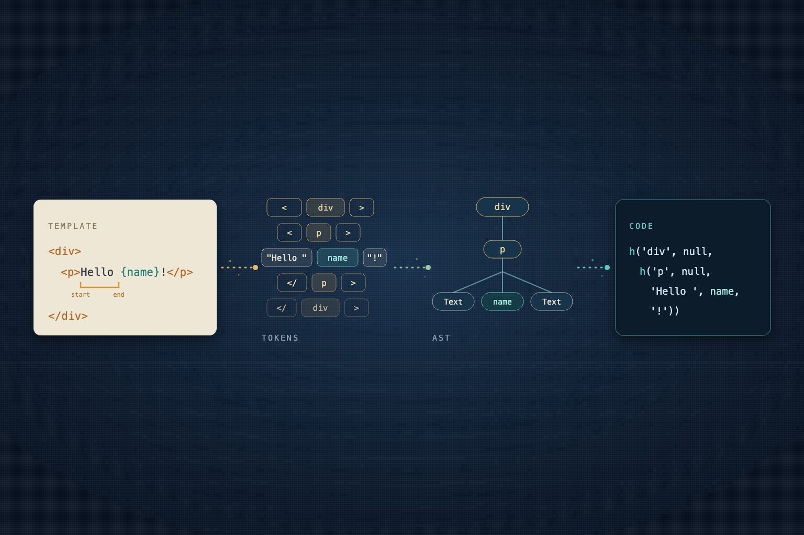

export const preload = async ({ id, origin }) => {
  const { views, date } = await fetch(`${origin}/api/views/${id}`).then(
    response => response.json()
  );
  return {
    layout: {
      views,
      date,
      title: 'Breaking Free from JSX: Building My Own Template Parser',
      description:
        'Could I turn UI written as tags into function calls without a JSX transformer? I rebuilt the Lithent template parser with AI as my teacher. This post follows it through the lexer, parser, transformer and code generator, and covers the tricky boundary problems I ran into along the way.',
      openGraph: {
        title: 'Breaking Free from JSX: Building My Own Template Parser',
        description:
          'Could I turn UI written as tags into function calls without a JSX transformer? I rebuilt the Lithent template parser with AI as my teacher. This post follows it through the lexer, parser, transformer and code generator, and covers the tricky boundary problems I ran into along the way.',
        images: [
          {
            url: '/assets/posts/breaking-free-from-jsx.jpg',
            width: 1536,
            height: 1024,
          },
        ],
      },
    },
  };
};



I have a bit of an obsession. When I find a convenient tool, I use it happily, and then at some point I start worrying that I depend on it too much. Watching the heyday of jQuery, which seemed like it would last forever, come to an end, I thought the React trend might end someday too. What scared me was that if React or JSX disappeared, I might lose the convenient ways of working I had taken for granted along with them.

Even while building Lithent, a virtual DOM library, I left JSX transformation to the JSX option of an existing JavaScript parser. If someone suddenly told me tomorrow that I couldn't use JSX anymore, where would I even start? Looking back, it is a somewhat excessive worry. Still, I thought that if I understood the mental model of turning UI expressed as tags into function calls, and actually implemented it properly, I could rebuild it with my own hands whenever I needed to, without an existing JSX transformer.

So a while ago I built a small template parser prototype. While figuring out where to cut the string, I set up two positions, `start` and `end`. I left `start` where it was and moved only `end`, and when it hit the `<` or `>` I was looking for, I moved `start` up to `end`. The characters gathered before that point were passed along as one chunk. At the time I came up with this approach on my own and simply named the function `search()`. [The search() from back then](https://github.com/superlucky84/lithent/blob/4754708bb930a929c7c4ef1956e0d5927cd36072/packages/compiler/src/step1.js#L15-L53)

I built a tree from the tags I read that way. When I met an opening tag I went down into a child, and when I met a closing tag I went back up to the parent. After cleaning up attributes and text, I walked the tree again and chained together `h()` calls. Looking at it again, the three steps I built back then correspond to parsing, tree transformation and code generation. I had implemented them by feel without knowing their names. [The prototype from back then](https://github.com/superlucky84/lithent/tree/4754708bb930a929c7c4ef1956e0d5927cd36072/packages/compiler)

After that, the wish to rebuild it properly stayed with me. Much later, I started getting a lot of help from AI at work. This time I decided to rebuild it while studying the structure of a parser, with AI as my teacher.

In my eyes, JSX was nearly perfect. The one thing I found lacking was how conditions and loops are written. When JavaScript expressions like `ready && <Panel />` or `items.map(...)` are nested several layers deep between tags, the tag structure that makes up the screen is hard to take in at a glance.

I learned by watching senior developers keep templates and business logic strictly apart. Maybe that made me a little obsessive about the separation too. When other developers compared JSX with Vue templates and pointed out the same thing, I nodded along.

So I wanted my template syntax to have at least directives for conditions and loops. Like Vue's `v-if` and `v-for`, if you attach `l-if` and `l-for`, you can tell right from the opening tag under what condition an element is shown and which list it repeats over. To my mind, it was the minimum syntax I added so that the structure of the screen reads first. What I built that way is `lithentTemplateParser`, which turns Lithent templates into `h()` calls.

I still reach for regular expressions first when I deal with strings. Regular expressions alone are often enough. But if I know how parsers work, won't I have one more thing to try when a problem is awkward to solve with regular expressions?

## From one line of template to a function call

What a template compiler does is turn a string that describes UI into code that the browser's JavaScript engine can run. In Lithent, elements become `h()` function calls. In the example below, the result of the call that creates `p` is passed as a child argument to the outer `div` call. When the browser runs that code, `h()` creates virtual DOM nodes following this structure. [Lithent's h()](https://github.com/superlucky84/lithent/blob/72222f3f7128d648b71b47f46f2865a7c9d3b2bc/src/wDom.ts#L45)

```html
<div><p>Hello {name}!</p></div>
<!-- generated code → h('div', null, h('p', null, 'Hello ', name, '!')) -->
```

First, it finds the boundaries between tags and body text in the string. Then it represents the relationship that `p` is inside `div` as a tree, refines the tree if needed, and writes it back out as JavaScript code. `compile()` handles this in four stages. [compile() source](https://github.com/superlucky84/lithent/blob/72222f3f7128d648b71b47f46f2865a7c9d3b2bc/packages/lithentTemplateParser/src/compiler.ts#L9)

1. The **lexer** reads the string from the front and turns pieces such as tag names or body text into tokens. `tokenize()` is the function that starts this tokenizing work.
2. The **parser**, in `parse()`, groups tokens according to the grammar and builds a tree (AST) that records which element is nested where.
3. The **transformer**, in `transform()`, groups consecutive conditional branches and cleans up indentation whitespace, refining the tree into the shape code generation needs.
4. The **code generator**, in `generate()`, walks the transformed tree and assembles the `h()` calls and their arguments into a JavaScript code string.

### How the lexer groups characters into tokens

The lexer's job is easy to follow if you picture two pointers, `start` and `end`, that mark the beginning and end of a piece within the string. `start` is where reading of the current piece began. Everything before it has already been processed. `end` is the position being examined right now. Keeping `start` in place, you move `end` forward, and when you find the spot where the piece ends according to the grammar, you record everything from `start` up to just before `end` as one token. Then you move `start` to the first position of the next piece and repeat.

Suppose we split words by spaces and read `"ab c de"`. At first, both `start` and `end` are 0. When `end` reaches the space at position 2, `slice(0, 2)` gives `ab`. After skipping the space, `start` moves to position 3, where `c` is, and reading starts again. The last word becomes a token at the end of the string.

```text
start = 0, end = 2  →  "ab"
start = 3, end = 4  →  "c"
start = 5, end = 7  →  "de"
```

In the actual Lithent code, the cursor that moves is `position`. For example, `readText()` saves the position where it starts reading in `start`, and the position where it stops before `<` or `{` in `end`. Each token holds the range found this way, its content, and the kind of piece it is. In the opening example, `<` is recorded as a tag start, `div` as an identifier, and `Hello ` as text. [Lithent's readText()](https://github.com/superlucky84/lithent/blob/72222f3f7128d648b71b47f46f2865a7c9d3b2bc/packages/lithentTemplateParser/src/parser/lexer.ts#L438)

The important thing here is the difference between **looking** and **consuming**. `peek()` looks at the character at the current `position`. `peek(1)` looks at `input[position + 1]`, one step ahead of that spot. The `1` is only used to compute where to look, so the value of `position` stays the same. Looking at characters ahead without moving the cursor like this is called **lookahead**.

If the two characters checked this way are `<` and `/`, it enters the function that reads a closing tag. Inside, it calls `advance()` twice to consume the two characters. **Consuming** means reading the current character and actually moving `position` one step forward to the next character. Line and column information is updated at the same time. [Lexer source](https://github.com/superlucky84/lithent/blob/72222f3f7128d648b71b47f46f2865a7c9d3b2bc/packages/lithentTemplateParser/src/parser/lexer.ts#L47)

Here are the tokens for the first line of the example, abbreviated as `TYPE(value)`. The trailing space of `Hello ` is part of the token value.

```text
TAG_OPEN_START("<") IDENTIFIER("div") TAG_OPEN_END(">")
TAG_OPEN_START("<") IDENTIFIER("p")   TAG_OPEN_END(">")
TEXT("Hello ") EXPRESSION_START("{") EXPRESSION_CONTENT("name") EXPRESSION_END("}") TEXT("!")
TAG_CLOSE_START("</") IDENTIFIER("p")   TAG_OPEN_END(">")
TAG_CLOSE_START("</") IDENTIFIER("div") TAG_OPEN_END(">")
EOF
```

### How the parser finds parents and children in the tokens

In the lexer, `position` was the location of the character to read next in the string. In the parser, `position` is the index of the token to read next in the token list. Here too, `peek()` checks the current token while leaving the cursor in place, and `advance()` consumes that token and moves on to the next position.

`parseElement()` reads the name of the opening tag, then reads child nodes one at a time until a closing tag appears. If it meets another opening tag while reading children, it calls `parseElement()` again.

In the example, it goes in to read `p` in the middle of reading `div`. The call reading `p` checks all the way to `</p>` and returns its own node, and the waiting `div` side takes that node as a child. Because each function call remembers the tag name it opened, if the closing order gets tangled, as in `<div><p></div>`, it can raise an error right where it was reading `p`. Having a function for each grammar rule and calling the matching function whenever you meet an inner structure is called **recursive descent parsing**. [parseElement() source](https://github.com/superlucky84/lithent/blob/72222f3f7128d648b71b47f46f2865a7c9d3b2bc/packages/lithentTemplateParser/src/parser/parser.ts#L120)

```text
Root
└─ Element("div")
   └─ Element("p")
      ├─ Text("Hello ")
      ├─ Interpolation("name")
      └─ Text("!")
```

The tree built this way is the **AST (Abstract Syntax Tree)**. The `<p>` and `</p>` that were read separately in the token list are combined into a single `p` element node in the tree. The `{name}` in the body becomes an interpolation node called `Interpolation`. This node stores the expression as a string, like `expression: 'name'`.

When generating code, this expression goes into the `h()` call without quotes. When the browser runs the generated code, it reads the value of the variable `name` at that moment. For example, if `name` is `'Ada'` at run time, the screen shows `Hello Ada!`.

### Grouping conditional branches into one unit in the transform

The transform is the step that refines the AST built by the parser ahead of time, so that the next step can easily produce the final result, the `h()` call code. In Lithent, it first groups conditional branches, and then, with the default settings, merges adjacent text and cleans up whitespace. [Transform order](https://github.com/superlucky84/lithent/blob/72222f3f7128d648b71b47f46f2865a7c9d3b2bc/packages/lithentTemplateParser/src/transform/index.ts#L8)

Once there is an AST, you can follow parent, child and sibling relationships without scanning character positions again. With the code in tree form, conditional branches that span sibling elements, like `l-if` and `l-else`, become easier to handle.

```html
<section>
  <p l-if={ready}>Ready</p>
  <!-- when the state changes, the branch below -->
  <p l-else>Waiting</p>
</section>
```

Right after parsing, the tree holds the two `p` elements written in the template side by side as children of `section`. When rendering, only one `p` goes into that spot. If `ready` is true, it shows "Ready"; if false, "Waiting". The parent and order of the two nodes are already in the tree, so what the code generator still needs to be told is that **these two are branches chosen by a condition for the same spot**.

So the transform looks through the children of the same parent in order, starting after the node with `l-if`. It skips whitespace-only text and comments, and groups the following `l-else-if` and `l-else` together with the preceding `l-if` into one conditional group. [Code that groups conditional branches](https://github.com/superlucky84/lithent/blob/72222f3f7128d648b71b47f46f2865a7c9d3b2bc/packages/lithentTemplateParser/src/transform/directives.ts#L36)

I expected the two `p` elements to remain siblings after the transform. I spent a long time thinking about why the AI bothered to group them separately. With everything from `l-if` to `l-else` bundled into one unit in the tree, it was immediately clear how much should become a single conditional expression. The first `p` stays in the child list as the representative, and both branches go into that node's `__conditionalGroup` property.

If an `l-else` does not follow a conditional branch that started with `l-if` under the same parent, the transform throws an error. For example, if a regular element like `<hr />` sits between `l-if` and `l-else`, the conditional branch is broken.

### Building `h()` calls in the code generator

The code generator walks the transformed tree again and assembles each element in the form `h(tag, props, ...children)`. Text is output as string literals, and the `name` that was in the interpolation goes in as a JavaScript expression. So the line from the beginning becomes the code below. [Element code generation](https://github.com/superlucky84/lithent/blob/72222f3f7128d648b71b47f46f2865a7c9d3b2bc/packages/lithentTemplateParser/src/codegen/createElement.ts#L110)

```js
h('div', null, h('p', null, 'Hello ', name, '!'))
```

Neither element has attributes, so the second argument is `null`. If you add a static attribute like `class="greeting"`, a string value goes into props, and if you add a dynamic attribute like `onClick={handleClick}`, code that references `handleClick` goes in. [Code that assembles props](https://github.com/superlucky84/lithent/blob/72222f3f7128d648b71b47f46f2865a7c9d3b2bc/packages/lithentTemplateParser/src/codegen/createElement.ts#L159)

The code generator turns the two branches grouped earlier into a single ternary expression. The code to run when `ready` is true goes after `?`, and the code to run when it is false goes after `:`. [Conditional code generation](https://github.com/superlucky84/lithent/blob/72222f3f7128d648b71b47f46f2865a7c9d3b2bc/packages/lithentTemplateParser/src/codegen/createElement.ts#L252)

```js
h('section', null, (ready) ? h('p', null, 'Ready') : h('p', null, 'Waiting'))
```

Loops turn into JavaScript code in the end too. For example, compiling `<li l-for={item in items} l-if={item.done}>{item.label}</li>` gives `(items).map(item => (item.done) ? h('li', null, (item.label)) : null)`. When a loop and a condition are on the same element, the conditional expression goes inside the `.map()` callback. Thanks to that, the callback's `item` can be read when the condition is evaluated. This is where the template's order of execution shows up directly in the output code. [Loop code generation and condition order](https://github.com/superlucky84/lithent/blob/72222f3f7128d648b71b47f46f2865a7c9d3b2bc/packages/lithentTemplateParser/src/codegen/createElement.ts#L213)

## Hard problems I ran into while implementing it

### Which brace closes the expression?

```html
<p>{format({ mark: '}' })}</p>
```

If you stop reading at the first `}` you see, you cut in the wrong place, inside the string value `'}'`. Even if you stop at the next `}`, the one that closes the object, you miss the end of the outer expression. The implementation reads the outer `{` and starts at depth 1. The inner object's `{` makes it 2, and quoted strings are skipped as a whole. When the object closes, it is 1, and it only reaches 0 at the last `}`. When it meets `${...}` inside a backtick string, it calls the same scan function again on the expression inside. It also skips comments and regular expression literals so that braces inside them are not counted. [Brace boundary scan](https://github.com/superlucky84/lithent/blob/72222f3f7128d648b71b47f46f2865a7c9d3b2bc/packages/lithentTemplateParser/src/docPipe/scan.ts#L175)

Once it finds that far, the lexer can pass `format({ mark: '}' })` along as a single expression token. Checking JavaScript syntax is left to whatever tool reads that code afterward. For example, `{value +}` passes the template compile step because its closing brace can be found, but a syntax error occurs at the step that reads the generated code as JavaScript.

### Telling whether an angle bracket is part of a tag

```html
<p title="a > b">{a < b}</p>
```

The `>` in the `title` attribute is inside quotes, and the `<` in `{a < b}` is a comparison operator. While reading a tag, the lexer skips the whole quoted string and goes on to the `>` after the closing quote. Inside braces, the JavaScript context has to be examined separately. [Code that finds tag boundaries](https://github.com/superlucky84/lithent/blob/72222f3f7128d648b71b47f46f2865a7c9d3b2bc/packages/lithentTemplateParser/src/docPipe/scan.ts#L204)

When looking for templates across a whole file, you also have to tell what role a `<` plays. The `<` on the first line compares `a` and `b`. On the second line, the template the arrow function returns starts at `<`.

```js
const less = a < b;
const View = name => <p>Hello {name}!</p>;
```

`scanTemplates()` reads JavaScript tokens one at a time and records in `expressionAllowed` **whether a new expression can start at the next position**. When it meets `<` while that value is true, it tries to extract a template. [JavaScript tokens and scan state](https://github.com/superlucky84/lithent/blob/72222f3f7128d648b71b47f46f2865a7c9d3b2bc/packages/lithentTemplateParser/src/docPipe/scan.ts#L97) · [Searching for template candidates](https://github.com/superlucky84/lithent/blob/72222f3f7128d648b71b47f46f2865a7c9d3b2bc/packages/lithentTemplateParser/src/docPipe/scan.ts#L259)

1. On the first line, reading the identifier `a` makes `expressionAllowed` false. It stays that way even if a space follows. So `<` remains a comparison operator.
2. On the second line, the spot after `=>` is where the expression the function returns begins, so `expressionAllowed` is true. The `<p>` met here is a template candidate. `extractTemplate()` counts the nesting depth of tags to set the range up to `</p>`. [Template range extraction](https://github.com/superlucky84/lithent/blob/72222f3f7128d648b71b47f46f2865a7c9d3b2bc/packages/lithentTemplateParser/src/docPipe/scan.ts#L219)

`transformDocument()` replaces only the ranges found this way with the result of `compile()`. The Vite plugin that handles `.ltsx` uses this path too. [Document transform entry point](https://github.com/superlucky84/lithent/blob/72222f3f7128d648b71b47f46f2865a7c9d3b2bc/packages/lithentTemplateParser/src/docPipe/index.ts#L42) · [The call in the Vite plugin](https://github.com/superlucky84/lithent/blob/72222f3f7128d648b71b47f46f2865a7c9d3b2bc/packages/lithentTemplateVite/src/plugin.ts#L209)

```js
const less = a < b;
const View = name => h('p', null, 'Hello ', name, '!');
```

The code generator also uses `scanTemplates()` to find templates inside expressions in braces. In `{items.map(item => <Card item={item} />)}`, it finds the tag after the arrow and compiles it again, which gives `items.map(item => h(Card, { item: item }))`. [Transforming templates inside expressions](https://github.com/superlucky84/lithent/blob/72222f3f7128d648b71b47f46f2865a7c9d3b2bc/packages/lithentTemplateParser/src/codegen/createElement.ts#L328)

### Keeping a `<` between tags as body text

A `<` can also appear as a plain character in the body between tags.

```text
<p>1 < 2 and 3 < 4</p>
```

When Vue 2's HTML parser finds a `<`, it checks whether an opening tag, closing tag or comment pattern starts at that position. If no pattern matches, it includes that `<` in the body text and finds the next candidate with `indexOf('<', 1)`. In this example, it passes `< 2` and `< 4`, and when it reaches `</p>`, it cuts everything before that into a single chunk of text, `1 < 2 and 3 < 4`. [Vue 2's text scan loop](https://github.com/vuejs/vue/blob/v2.6.14/src/compiler/parser/html-parser.js#L108-L133)

I remember treating this case as an edge case and handling it separately at some point. Looking at the code again while writing this post, after it had gone through other work in the meantime, I found that the handling that keeps a `<` in body text as a character was missing. Right now `readText()` stops at the first `<`, and compiling the example above as-is gives an `Expected tag name` error. I plan to fix this. [Lithent's readText()](https://github.com/superlucky84/lithent/blob/72222f3f7128d648b71b47f46f2865a7c9d3b2bc/packages/lithentTemplateParser/src/parser/lexer.ts#L438)

### When a single space has to stay

In `<p><b>Hello</b> <i>world</i></p>`, if you throw away the space between the two elements, the screen shows `Helloworld`. In the first example, `Hello {name}!`, the space after `Hello` matters too. So when compiling, the parser first keeps whitespace as text nodes. Then the transform merges adjacent text and removes whitespace-only nodes that contain line breaks. If there is text at either end of a child list, the outer whitespace is trimmed as well.

Inside `pre` and `textarea`, indentation and leading or trailing whitespace can be the content itself. When processing the children of these two tags, whitespace removal and trimming are turned off. So the indentation and the final line break in the example below remain in the generated code. [Text and whitespace optimization](https://github.com/superlucky84/lithent/blob/72222f3f7128d648b71b47f46f2865a7c9d3b2bc/packages/lithentTemplateParser/src/transform/optimize.ts#L41)

```html
<pre>
  Hello {name}
</pre>
```

```js
h('pre', null, '\n  Hello ', name, '\n')
```

## What stayed with me after reading it again

I wanted to write about this from the moment I first built `lithentTemplateParser`. I kept putting it off, and it took quite a while before I finally opened the code again and organized it into a post.

When I built the parser with AI's help, I looked carefully at how the code worked and checked the edge cases one by one. But when I opened it again after some time, even the parts I thought I had understood felt pretty unfamiliar. In the end, it took me a long time because I had to read the code again from the beginning. I forget even code I typed character by character with my own hands as time passes, but the code I built with AI's help became unfamiliar to me even faster.

In an era when AI writes even the code, I sometimes wonder whether I really need to know this much. Still, when I reopen code that AI built for me, I want to know where to start reading and understand why it works the way it does. That seems to be how I can keep a grip on the code when the next time comes to work on it.

`lithentTemplateParser` still falls short of fully replacing JSX. There are gaps left to fill, like the `<` in body text. Even so, I learned a lot while building it, and I'm satisfied with how it turned out. I no longer feel anxious about a world without JSX.
