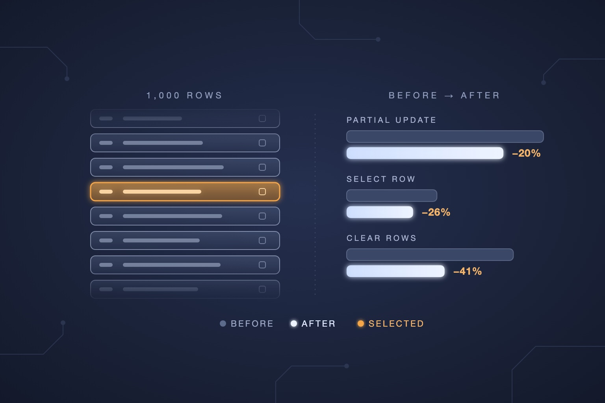

export const preload = async ({ id, origin }) => {
  const { views, date } = await fetch(`${origin}/api/views/${id}`).then(
    response => response.json()
  );
  return {
    layout: {
      views,
      date,
      title: 'Tuning Lithent for js-framework-benchmark',
      description:
        'I wanted to put Lithent on js-framework-benchmark, so I worked on its rendering performance with an AI agent. Some of the code I had written most carefully turned out to be the bottleneck. Here is what I learned about caching, removal, events and memory reclamation.',
      openGraph: {
        title: 'Tuning Lithent for js-framework-benchmark',
        description:
          'I wanted to put Lithent on js-framework-benchmark, so I worked on its rendering performance with an AI agent. Some of the code I had written most carefully turned out to be the bottleneck. Here is what I learned about caching, removal, events and memory reclamation.',
        images: [
          {
            url: '/assets/posts/tuning-lithent-for-js-framework-benchmark.jpg',
            width: 1536,
            height: 1024,
          },
        ],
      },
    },
  };
};



I started [Lithent](https://github.com/superlucky84/lithent) because I wanted to build a very small virtual DOM library that keeps state in closures. At first I never thought about speed. I focused on making it behave exactly the way I intended while keeping the library small.

Only after I had implemented most of the behavior I had in mind did I start to care about speed. I wondered how fast the current structure really was and where it could improve, and I wanted to put it on `js-framework-benchmark`.

When I started building Lithent, developing with the help of AI was not yet a thing. After years of working on it, I found myself in an era where we build software together with AI.

For this round of rendering performance work, I deliberately leaned on an AI agent. We listed the candidates that might be bottlenecks and decided together which fixes would have the biggest effect. Starting with the highest priority, I changed the code and checked each change with tests and benchmarks.

While diagnosing possible slowdowns and trying out fixes, I kept bundle size as an important criterion. I did not want to give up the library's small size for speed. I tried to improve things while staying in the 4KB range (Brotli-compressed minified UMD). Candidates that made things faster but gave too little for the size they added were dropped.

Testing them one by one, I found that some of the parts I had worked hardest to get exactly right were actually the bottleneck. These were honestly written pieces of code: removing DOM nodes one at a time, and releasing every event listener without missing one. I already knew that you can assign `undefined` instead of using `delete` to clean up an object, but I only felt how much that choice can matter for performance after optimizing with an AI agent. And moving the place where a one-line function was created let the memory of the previous screen be reclaimed.

## Selecting a single row was heavy even with a cache

In the [previous post](/2026/8/10/refactoring-key-diff-in-my-own-virtual-dom), I used Map matching and LIS (longest increasing subsequence) to cut down unnecessary searching and DOM moves. Even after that, selecting a single row still had a cost.

When the selection moves from row A to row B, only two rows actually change. But the original benchmark app re-rendered every row when the parent updated, creating new event functions and new virtual DOM along the way. Even with minimal DOM moves, JavaScript had a lot of work to do before that.

Lithent already had a helper called `cacheUpdate`. When I first added it, I had in mind something like React's `memo`, which skips rendering work for components that have not changed. So the first thing I did was apply this cache to the rows in the benchmark app. If the label and the selection state were the same, it returned the previous virtual DOM, and each row's event handler was created once and reused. But even with the cache in place, selecting a row did not get as light as I expected.

There was something I had overlooked. A Lithent component is split into a mounter, which runs only once at the beginning, and an updater, which runs on every update. Since the mounter runs only once anyway, I thought it would be enough to cache only the updater, the part that runs many times. I built `cacheUpdate` that way: it wraps the updater.

```tsx
const Row = mount((renew, props) => {
  // Mounter: runs only once at the beginning.
  const onSelect = () => props.select(props.id);

  // Updater: runs on every update. This is where the cache goes.
  return cacheUpdate(
    () => [props.label, props.selected],
    () => (
      <tr class={props.selected ? 'danger' : ''}>
        <td onClick={onSelect}>{props.label}</td>
      </tr>
    )
  );
});
```

However, when the parent updates, the library does some work for each component before the row's updater is even called. It checks whether this is the same component as before, applies the new props and prepares the update. Only then does the updater, that is, the cache check, run. And after the cache returns the previous result, there is still work left to wrap that result up as the component's output.

```text
Parent update
→ For each row: check it is the same component → apply new props → prepare the update
→ Run the updater (cache hit: virtual DOM creation is skipped)
→ Wrap the returned result up as the component's output
```

All the cache skipped was building the virtual DOM inside the updater. The work repeated for every component before and after it stayed the same. **Not rebuilding the output and skipping the component's update procedure were different things.** Even though I had built this structure myself, I had missed the cost repeated outside the cache. I only learned how much it added up after measuring.

That cost grew with the number of rows. In a diagnostic that moved the selection to another row among 1,000 rows, this component update procedure ran 1,001 times (once for the parent and once for each of the 1,000 rows), even though only two rows had actually changed. [Analysis of the update cost left after a cache hit](https://github.com/superlucky84/lithent/blob/d594983/docs/benchmark/CORE_ANALYSIS.md#21-캐시-적중-후에도-남는-컴포넌트-비용)

So in the benchmark app I decided not to make rows components at all. When a row's data is created, the cached function that draws that row is created with it, and the Table calls that function directly.

```tsx
function createRow(id, label) {
  const onSelect = () => select(id); // Created only once, with the row.

  const row = {
    id,
    label,
    view: cacheUpdate(
      () => [row.label, selectedId === id],
      () => (
        <tr key={id} class={selectedId === id ? 'danger' : ''}>
          <td onClick={onSelect}>{row.label}</td>
        </tr>
      )
    ),
  };

  return row;
}

const Table = mount(() => {
  return () => <Fragment>{rows.map(row => row.view(row))}</Fragment>;
});
```

Since a row is no longer a component, the work before and after the updater that we saw above is gone. When the Table updates, each row only runs its cache check, and rows that have not changed return their previous result as is.

This is not the usual way to use the library. In an ordinary app it is more natural to keep rows as components, and that is how I would build it too.

Still, I do not think this code fools the library or sidesteps any rules. In Lithent, a function can hold its own data and handlers in a closure without being a component. If a row needs no state or lifecycle of its own, there is no need to make it a component.

I left the library code as it was, changed only the app, and compared before and after with the benchmark's official measurement tool. The difference was quite large.

| Operation      |   Before |    After | Total time reduction |
| -------------- | -------: | -------: | -------------------: |
| Partial update | 22.100ms | 17.592ms |                20.4% |
| Select row     | 10.136ms |  7.460ms |                26.4% |
| Clear rows     | 18.713ms | 10.996ms |                41.2% |

The score that combines the benchmark's nine results with fixed weights (the weighted score from here on) dropped by about 13.8%. I had not changed a single line of library code, yet the difference was this big. Improving the library matters, but I felt that knowing the library's characteristics and how to use them matters just as much. [Before-and-after measurement of the app](https://github.com/superlucky84/lithent/blob/d594983/docs/benchmark/PRODUCTION_RESULTS.md)

What I learned here is that putting a cache in place does not make the work before and after it disappear. I had to look concretely at what the cache actually skips.

### I still do not like caches

To be honest, I do not really like features such as `memo` or `cacheUpdate`, even though I built `cacheUpdate` myself.

In Lithent, functions and state that a component needs only once can live in the mounter. The closures and functions created there are reused on every update. Event handlers do not need to be recreated in the updater each time either. When I chose this structure, I assumed there would be little reason to think about a separate cache just to keep functions and closures alive.

This time I learned that the update procedure each component goes through also has a cost, and that it shows up in fine-grained performance measurements like these. Some objects, such as virtual DOM, are still created on every update. Even so, I believe that if you design carefully where functions and closures are created and what gets updated, you can keep repeated memory allocation low enough. The small update cost I found here does not feel like a serious problem with the structure.

Come to think of it, using a feature like `memo` at all is close to a trick for working around a weakness of the virtual DOM. When state changes, a virtual DOM redraws the screen and compares it with the previous result to find what changed. Even if only one line actually changed, redrawing and comparing happen across the whole redrawn area. A cache is a device for skipping that work. This is not just a Lithent story. Every framework that uses a virtual DOM fundamentally has the same problem, which is why each one has a similar device.

In this benchmark I used that trick actively because I wanted to improve the visible numbers, and I confirmed that it works. Still, I do not want to depend on features like this when building everyday apps. I still believe that a well-designed structure gives you perfectly usable speed without a separate `memo`.

## The code that carefully removed nodes one by one was the bottleneck

From here on, the story is about fixing the library itself. The bottleneck that struck me most was clearing all rows.

When I first implemented it myself without any help from AI, I called `remove()` for each DOM node to be removed. I thought finding exactly what to remove and removing each one was the most reliable way. In my eyes it was a very honest implementation.

I think I had an obsession with implementing things precisely, without skipping a single step, like a computer. Because I paid so much attention to handling each item properly, I did not see that I could take advantage of the situation where every child under a parent was being removed.

That is when the AI pointed out a faster path: if the items to remove are all of a parent's children, you can empty the parent in one go. That let me cut down the calls I had been repeating for the sake of precision. But the parent must not contain anything else, so I added code to check that the items to remove were all of the parent's children.

This time, though, the check needed to use the fast path became the bottleneck itself. The problem was where this check was called.

It happened when the rows of a list were components. Changing the benchmark app's rows so they were no longer components came later. The app before that, and many ordinary apps, make rows components. When rows are components, this check was called again every time a single row was removed, and each time it counted the parent's children from the beginning.

If you remove 1,000 rows, it goes like this.

| Row being removed | Children checked |
| ----------------- | ---------------: |
| 1st               |            1,000 |
| 2nd               |              999 |
| 3rd               |              998 |
| …                 |                … |
| Last              |                1 |

That adds up to about 500,000 checks. If the number of rows doubles, the number of checks quadruples. The preparation work to see whether a fast removal was possible was doing far more work than the removal itself. In the profile at the time, about 73% of the time spent clearing rows was in this function.

First, I made calls that came in to remove the contents of a single row skip the counting entirely. The check only runs when several items are removed at once. In a diagnostic setup with the CPU slowed down four times, clearing rows went from 76.7ms to 15.9ms. That is a different condition from the official measurement tool's scores, but it showed how much time had gone into the repeated checks. [Record of the removal bottleneck and the fix](https://github.com/superlucky84/lithent/blob/d594983/docs/benchmark/STATUS.md)

Next, I made the counting stop as soon as it passes the number of items to remove. If there are two items to remove and you have already seen a third child, there is no need to count the remaining thousands. You already know the whole parent cannot be emptied.

Later, I changed it to check whether the actual DOM nodes match instead of comparing counts. It goes into components to find the DOM nodes to remove and compares them, in order, with the parent's children to see whether they are the same objects. It empties the parent in one go only if they match all the way, and stops right there if something different shows up. This way, even if outside code replaces a DOM node that the library manages, that node does not get removed along with the rest. Strictly speaking, outside code touching an area managed by a virtual DOM is not correct usage. Still, the library is that much safer if it does not remove the wrong DOM when it is used incorrectly.

I never really wanted to compare DOM nodes changed by outside code this carefully when I first implemented it. I thought keeping the library small and making the code do less was the better trade-off. The simple implementation was a deliberate choice.

If I had done this alone without AI, I probably would have chosen the trade-off again and stopped there. I was able to cover cases like this, which only come up with incorrect usage, because the AI reviewed this part all the way through.

This check was not free either. For plain DOM rows, which could already be removed in one go, there were signs that run time might go up by about 1%. But it went up or down depending on the measurement order, so I did not treat it as a definite loss. On the other hand, lists whose rows are components could now be emptied at once instead of removing DOM nodes 1,000 times one by one, and the time to clear rows measured with the official tool dropped from 13.311ms to 12.267ms, about 7.84%. [Gains and costs of the follow-up removal implementation](https://github.com/superlucky84/lithent/blob/d594983/docs/benchmark/BULK_REMOVAL_V2_RESULTS.md)

To empty the whole parent without removing outside DOM as well, this check was necessary. So I accepted the possibility of a small extra cost for plain DOM rows in exchange for bulk removal of component rows and a safety net for incorrect usage.

## I tried to release every single event listener

Cleaning up events was something I cared about a lot from the very first implementation of Lithent.

When `destroy()` is called or a component's lifecycle ends, I wanted every event attached to the DOM to be released as well. Every event registered through a prop with the `on` prefix, such as `onClick` or `onInput`, had `removeEventListener` called on it without exception. I put a lot of effort into walking down through child DOM nodes so that no event was left behind.

But that carefully built cleanup was one of the bottlenecks when clearing rows. Even with just two events per row, removing 1,000 rows adds thousands of release calls. I was walking through DOM nodes that were about to disappear from the screen and detaching their events one by one.

Once nothing references a DOM node and its listeners anymore, the browser can clean both up from memory together. There was room to cut the work I spent releasing every event on DOM that was being thrown away.

So I stopped releasing listeners one by one on plain DOM nodes that are being discarded. In a diagnostic that compared only this change, the median time to clear rows went from 9.6ms to 8.2ms. That is a different condition from the official measurement tool's scores, but it confirmed that releasing events one by one also had a cost. [Measurement of skipping listener release](https://github.com/superlucky84/lithent/blob/d594983/docs/benchmark/STATUS.md#54-코어-버려지는-dom의-리스너-해제-제거--수정함-미커밋)

Of course, detaching DOM from the screen does not by itself mean the memory is reclaimed right away. If a user keeps a removed DOM node somewhere, its listeners can stay too, and dispatching an event to that node can still run its handler. So cleanup for DOM that stays alive is kept as it was: releasing a handler when it changes or goes away, cleanup functions that run when a component disappears, and event cleanup for content rendered elsewhere through a portal.

Seeing how often the code I thought I had written so carefully actually ran, I realized how narrow my view can become when I get absorbed in one thing. Building a library like this keeps you questioning the computation and the correctness of the behavior, and I think I got so absorbed in that that I could not see the forest.

I usually try not to get buried in diligence and end up working inefficiently, and I try to find smarter ways to do the same work. Even so, I was so focused on releasing every single event that I never asked whether I really had to do all of it myself.

## A one-line function was delaying memory reclamation

I have cared about memory use and reclamation from the beginning. I kept testing repeatedly to make sure memory usage did not keep piling up.

That said, I never thought memory had to be reclaimed the instant it was no longer used. I accepted that there would be some delay before reclamation, and that memory usage might look higher in the meantime.

This time, though, while testing repeated updates more relentlessly to squeeze out every bit of performance, I found that the memory of previous screens stayed around longer than expected.

After keeping 1,000 rows and running 100 partial updates, the JS heap still reached about 17.77MB even after forcing garbage collection (GC). It was a problem that had not really shown up in a few rounds of creating and clearing everything.

The code involved was a getter that finds the parent. Virtual nodes use this function to find the real DOM parent and the insertion position.

Here is a simplified version of the structure at the time.

```ts
function reconcileChildren(newParent, oldParent) {
  const oldChildren = oldParent.children;
  const getParent = () => newParent;

  return newParent.children.map((child, index) => {
    return reconcile(child, oldChildren[index], getParent);
  });
}
```

On the surface, `getParent` only returns the new parent. But a JavaScript engine can keep the variables used by closures created in the same function together in one shared space. In this example, the long-lived `getParent` and the `map` callback that uses the previous children array (`oldChildren`) were created in the same function. In the environment I observed, that meant the previous virtual DOM was held on to longer than necessary for as long as `getParent` was alive.

The fix was to create the parent getter in a separate function.

```ts
const makeParentGetter = parent => () => parent;

// Inside the diff function, only the parent is passed in.
const getParent = makeParentGetter(newParent);
```

It returns the same value. By separating the environment in which the function is created, the getter now holds on to the parent alone.

Under the same repeated-update conditions, the JS heap after the fix was about **4.03MB**. A browser check using WeakRef also confirmed that before the fix, old nodes from 50 updates earlier were still alive, while after the fix only the current nodes remained. [Measurement and verification of memory reclamation](https://github.com/superlucky84/lithent/blob/d594983/docs/benchmark/PRODUCTION_RESULTS.md#부모-getter-회수-수정)

I felt that even a one-line closure I had not given much thought to can change when memory gets cleaned up, depending on where it is created. I also thought it might be better to have fewer nested functions, but I am not sure that is always the right answer. It was subtler than I expected.

## Cleaning up objects neatly also had a cost

The renderer attaches temporary information to nodes, such as the previous index, the previous props and the children to remove. Once the work is done they are no longer needed, so deleting them felt like the natural way to clean up.

```ts
delete node.oi;
delete node.op;
delete node.oc;
```

But adding and deleting properties every time a huge number of nodes are updated can keep changing the shape of the objects. That shape also affects how the JavaScript engine optimizes property access.

I already knew that you can assign `undefined` instead of using `delete`. But until I actually changed it and measured, I did not pay much attention to it. So for this temporary information, I kept the property slots in place and only emptied the values.

```ts
node.oi = node.op = node.oc = undefined;
```

If the value pointed to a previous object, assigning `undefined` is enough to cut the link. There was no need to remove the property itself just to let go of the object. Props that a user has actually removed, however, are still deleted along with the property.

Component props had similar repeated work. Instead of deleting every key from the existing object and copying the new values in, I changed it to delete only the keys that disappeared and update the rest. This keeps the props object that the component references through its closure, while avoiding needless deletion and re-adding.

After that, I changed the virtual DOM objects that used to be created differently for each kind, such as elements and text, so that a single factory function creates them all. It puts 13 frequently used properties in the same order and creates properties that have no value yet as `undefined` up front. The idea was to keep the JavaScript engine working with objects of a similar shape and reduce the cost of repeatedly reading and writing node properties. The remaining properties, used only by components or the root, are added only to the nodes that need them.

In a separate comparison of this change, the weighted score dropped by about **5.9%** and JS time by about **14.4%**. In return, memory for 10,000 rows grew by about **2.5%**, or 0.68MB. Reserving slots up front had its own cost. A bigger variant that initialized every field was not chosen because its memory increase was larger. [Node creation shape experiment](https://github.com/superlucky84/lithent/blob/d594983/docs/benchmark/NODE_SHAPE_RESULTS.md)

I could see these differences because the AI agent compared and measured several variants. Looking at the results, I started thinking about how far I was willing to grow memory and bundle size to gain a little more speed. At the time I was prioritizing the balance between speed and bundle size, so I accepted this much extra memory and chose the speed improvement.

## I kept recalculating things I already knew

After cutting the bigger computation costs, I looked for room to improve in relatively small places too. Of course, I was not the one who found them. The AI did. 😅

When I implemented the virtual DOM diff myself, the slightest deviation in the flow kept causing bugs, and it stressed me out a lot. So in some places I honestly layered defensive logic, checking the same condition one more time. I was more or less aware that some of that duplication was still there.

What I did not expect was that those small checks would affect fine-grained speed differences.

The path that adds new nodes had an unnecessary type comparison. Even when there was no previous node, it was checking whether the new node and the previous node had the same type. I added a condition so the comparison only happens when there is a previous node.

```ts
const sameType = !!originalWDom && compareType(newWDom, originalWDom);
```

The fix was small, but it was called a lot. At the time, the preparation work for comparing child nodes ran about 100,000 times when creating 10,000 rows. In a separate comparison with the official measurement tool, JS time for creating 1,000 rows dropped by about 4.5%. The total time, including browser rendering, dropped by about 1.0%. [Profile and comparison of the creation path](https://github.com/superlucky84/lithent/blob/d594983/docs/benchmark/CREATION_PROFILE.md)

Something similar happened with list updates. If you are only selecting one row, the order of the list stays the same, and most rows do not change their contents. Yet every time, it searched for each item again and even prepared to calculate whether anything needed to move.

I changed it to use what each step could already know a little earlier.

When there was no need to look up an item's position again, the search was skipped. For lists whose order was preserved, the preparation for reordering was skipped, and objects returned unchanged from the cache were not compared again. When the conditions do not hold, it falls back to the existing way.

When I develop, I usually reuse the functions I have already written as much as possible. I want to avoid having to think through and implement the same thing every time. That definitely helps while developing, but this time I felt that it does not make things faster. Even though I had less to think about, the computer kept doing the same calculation inside those functions.

I did not want to think any harder than I had to, so I thought I could just leave repetitive work to the computer. I figured I would have less to keep track of, and the computer could simply do more work. But that did not hold when performance had to be pushed to the extreme.

To be fair, it does seem more natural for me to take it easy and for the computer to do the heavy lifting… 🥲

Bundling these recent changes that cut small pieces of work and comparing them locally with the official measurement tool, the weighted score dropped by **2.59%**. Partial update dropped by **9.21%** and selection by **12.91%**. [Measurement of the latest optimization bundle](https://github.com/superlucky84/lithent/blob/d594983/docs/benchmark/POSITIONAL_KEYS_OFFICIAL_RESULTS.md)

Even the small checks I had not thought much of, the computer was repeating faithfully, every single time. Computers really are honest.

## I also rolled back an optimization that looked good

With AI's help, coming up with candidates became much easier. As a result, deciding whether to adopt them became more important.

A stable event proxy was one of them. The name sounds complicated, but it is not hard once you see how a virtual DOM handles events when it redraws the screen.

```tsx
<button onClick={() => select(row.id)}>Select</button>
```

When you create a function right inside JSX like this (an inline handler), a new function is created every time the screen is redrawn. The code is identical, but in JavaScript it is a different object from the previous function. While comparing the previous props with the new ones, the virtual DOM decides that `onClick` has changed. So on the real DOM it detaches the previous listener with `removeEventListener` and attaches the new one with `addEventListener`. If each of 1,000 rows has one such button, every update makes 2,000 DOM calls, even when nothing visible on the screen has changed.

An event proxy is a way to avoid this repetition. A fixed relay function (the proxy) is registered on the DOM only once at the beginning. When an event fires, this function looks up the latest handler stored on that element and calls it instead. When redrawing, the DOM listener is left alone and only the stored handler is swapped for the new function.

```text
Without a proxy: every update removeEventListener(previous function) → addEventListener(new function)
With a proxy: once addEventListener(proxy) → every update only the stored handler is swapped
```

When I built a separate 1,000-row screen that uses inline handlers and compared them, total time dropped by about 9.4% for selection and about 5.2% for partial updates.

But in Lithent this situation is not common. As I mentioned earlier, if you declare handlers in the mounter, which runs once when a component is first created, the same function is reused when redrawing.

```tsx
const Row = mount((renew, props) => {
  const onSelect = () => props.select(props.id); // Created only once, in the mounter.

  return () => <button onClick={onSelect}>Select</button>;
});
```

Since the function does not change, there is nothing to detach and reattach. Creating inline functions in the updater on every render is actually closer to a special case.

The benchmark app also reused its handlers, so there were zero listener re-registrations in selection and partial updates. It was not paying the cost that the proxy was meant to reduce in the first place. In the end, the event proxy was not an improvement that always pays off. The gain was limited to code that uses inline handlers, while every app would have had to pay for the proxy's size and memory, and for keeping it compatible with code that works with browser events directly. So the default implementation went back to the original approach of registering handlers directly on the DOM. [Record of restoring the event implementation](https://github.com/superlucky84/lithent/blob/d594983/docs/benchmark/NATIVE_EVENTS_RESULTS.md)

## What I checked before trusting the numbers

Trusting measurement results was trickier than I expected. Once, I changed only the removal code, and the result showed row selection time dropping by nearly 9%. Looking closer, the code had not become faster. The time spent waiting for the browser's turn to draw the next frame just happened to be shorter. A better number did not automatically mean the code I fixed had made a difference.

So I did not trust results on the first try. Even when alternating measurements before and after a change, the results shifted slightly depending on which one ran first. In those cases I measured once more in the reverse order and checked whether both results pointed in the same direction.

I also did not adopt a change just because it was faster. When you take shortcuts for speed, it is easy to drop something the code used to do. For example, if a list creates new elements instead of reusing existing ones when redrawing, the cursor can disappear while someone is typing in an input. Cleanup for components that disappear from the screen might not run, or the memory of previous screens might stay around. So I also checked that this behavior stayed the same. If a better benchmark number came at the cost of the original behavior, there was no reason to adopt it.

The improvement rates in this post are also comparisons from different points in time. You cannot add up the 13.8% from the app change, the 5.9% from the node creation shape and the 2.59% from the latest bundle into one overall improvement rate. Because I kept measurement records, I could check how far I could go in my claims even while writing this post now.

## So how much faster did it get?

When I first measured Lithent with the official measurement tool, it was the slowest of the libraries I compared. Below are the weighted scores measured together under the same conditions, right after the app structure change described above. vanillajs, which works with the DOM directly without a framework, is set to 1, and lower is faster.

| Implementation      | Weighted score |
| ------------------- | -------------: |
| vanillajs           |          1.000 |
| Svelte              |          1.123 |
| Solid               |          1.144 |
| Vue                 |          1.250 |
| **Lithent (after)** |      **1.388** |
| Preact hooks        |          1.529 |
| React hooks         |          1.565 |
| Lithent (before)    |          1.609 |

These are local results measured on my computer, not scores from the published official results table. Library improvements such as the node creation shape and list updates continued after this measurement. [Comparison under the same conditions](https://github.com/superlucky84/lithent/blob/d594983/docs/benchmark/PRODUCTION_RESULTS.md)

## The fun of digging into small differences

To be honest, at first I secretly looked down on this kind of rendering performance measurement. I wondered whether it really mattered that much for people to argue over tiny time differences. Even React, which is already mainstream, is not always fast in benchmarks like this. In the local comparison I recorded this time, React was also relatively slow at swapping rows and creating 10,000 rows. [React and Preact comparison at the time](https://github.com/superlucky84/lithent/blob/d594983/docs/benchmark/PEER_BASELINE_RESULTS.md#cpu-전체-시간과-목표)

But once I focused on rendering performance myself, digging into those differences turned out to be fun. I learned that even a trivial-looking bit of function handling, repeated enough, creates delays that show up as small performance differences. Following the functions and arrays I had been creating every time, and the checks that kept running even after the answer was known, I got to see how much work my code was really doing.

What felt especially ironic was that the parts I had worked so hard on, removing DOM nodes one at a time and releasing every event, were the bottlenecks. It was fascinating that I could do less of the work I had been so careful to do precisely and still get the result I needed. I confirmed that assigning `undefined`, which I already knew about, leads to real performance differences, and I saw that where the parent getter is created can change how long the previous screen lives. Changing the code, measuring again and coming to understand why the difference appeared was fun in itself.

Still, my belief has not changed that a framework's predictability and the transparency of its behavior matter more than tiny speed differences like these. I care more about being able to predict what will update in a given state and to follow the code to understand why it behaves that way.

While keeping that belief, I found unexpected fun in finding small costs and cutting them one by one.

In the end, all of this started because I wanted to put Lithent on this results table.

- [js-framework-benchmark results](https://krausest.github.io/js-framework-benchmark/)
- [js-framework-benchmark on GitHub](https://github.com/krausest/js-framework-benchmark)
- [Lithent on GitHub](https://github.com/superlucky84/lithent)
